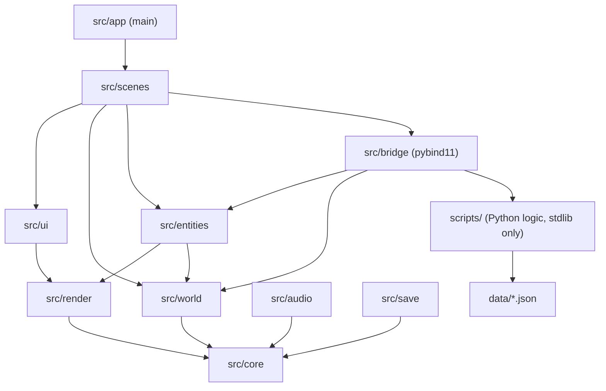

# 🏗️ ARCHITECTURE — Cây thư mục chuẩn & Phân chia trách nhiệm

> Gốc dự án: `d:\ProjectGame\` (tương đương `DinoSurvival/` trong [ke-hoach-game-master.md](file:///D:/PlanProjectGame/ke-hoach-game-master.md)).
> Nguyên tắc: **Domain-first (chia để trị)** — mỗi thư mục = 1 miền nghiệp vụ, có ranh giới rõ, phụ thuộc 1 chiều.
> Mẫu tham chiếu: FastAPI Best Practices (Netflix Dispatch) + SkillGame (`Core_Rules`, `Engine_Architecture`, `Level_Save`, `Testing`).

---

## 1. Bản đồ tầng (phụ thuộc 1 chiều, KHÔNG vòng)



- `core` không biết `world`/`entities`. `world` không biết `scenes`. Chỉ `bridge` chạm Python.
- Python **không** tự va chạm/vẽ: mọi lệnh di chuyển đi qua `game_engine.move_*` → C++ AABB (E5).
- Toàn bộ số liệu gameplay nằm trong `data/balance.json` (không magic number).

---

## 2. Cây thư mục đầy đủ

```text
d:\ProjectGame\
├── README.md                      ← Giới thiệu, build nhanh, phím điều khiển
├── RULES.md                       ← Luật bắt buộc cho người & AI (kiểu AGENTS.md)
├── CMakeLists.txt                 ← [Bước 1.1] target dino_engine (static lib) + DinoSurvival (exe) + tests
├── CMakePresets.json              ← [Bước 1.1] preset debug/release dùng toolchain vcpkg
├── vcpkg.json                     ← Manifest khóa thư viện C++ (feature "tests" = Catch2)
├── pyproject.toml                 ← Cấu hình ruff + pytest + mypy (Python 3.11)
├── .gitignore / .gitattributes / .editorconfig
│
├── requirements/
│   ├── base.txt                   ← pybind11 (build-time)
│   ├── dev.txt                    ← pytest, pytest-cov, ruff, mypy
│   └── tools.txt                  ← pillow, jsonschema (pipeline asset/data)
│
├── cmake/                         ← [Bước 1.1] module CMake tách nhỏ
│   ├── CompilerWarnings.cmake     ← /W4 /permissive- /utf-8 (Core_Rules §1.5)
│   └── CopyRuntime.cmake          ← copy assets/maps/data/scripts + DLL cạnh .exe
│
├── docs/                          ← Bộ nhớ dự án (Project_Memory_ADR)
│   ├── PROJECT_CONTEXT.md         ← Engine/phiên bản/tier/FPS đã khóa
│   ├── ARCHITECTURE.md            ← (file này)
│   ├── SETUP_AND_LIBRARIES.md     ← Danh sách thư viện + cách cài + setup ban đầu
│   ├── TASKS.md                   ← Checklist công việc 36 bước bám sát Master Plan
│   └── adr/                       ← Quyết định kiến trúc (bất biến)
│
├── typings/
│   └── game_engine.pyi            ← [Bước 1.7] Stub type-hint phản chiếu API PyBridge (hợp đồng E4)
│
├── art_src/                       ← NGUỒN MỸ THUẬT — KHÔNG ship
│   ├── original/                  ← Bản gốc copy từ D:\PlanProjectGame\GAME (kể cả .webp)
│   ├── reference/                 ← map_concept_art.png, ảnh tham khảo
│   └── prompts/                   ← map-image-prompts.md, character-image-prompts.md
│
├── assets/                        ← CHỈ file runtime đã chuẩn hóa (PNG RGBA / WAV / OGG / TTF)
│   ├── sprites/
│   │   ├── rex/                   ← rex_idle/run/attack/hurt/dead/sneak/level_up.png (32×32/frame)
│   │   ├── boar/                  ← boar_idle/walk/flee/dead/alert.png
│   │   ├── khen/                  ← boss_idle/patrol/charge/swipe/roar/dead.png (64×64/frame)
│   │   ├── mother_boar/           ← [V2] placeholder (180,70,50) 36×36
│   │   ├── baby_dino/             ← [V2] placeholder (120,235,130) 24×24
│   │   ├── herb/                  ← [V2] placeholder (16,230,150) 20×20
│   │   └── accessories/           ← [V2] evo_tyrant_spikes / evo_raptor_stripes / evo_pack_scarf
│   ├── tilesets/
│   │   ├── forest/                ← forest_tileset_complete.png + tile lẻ (grass, dirt, rock...)
│   │   ├── volcano/               ← [V2] volcano_tileset, lava sheet
│   │   └── overlays/              ← [V2] hoa nở / héo úa (Territory)
│   ├── effects/
│   │   ├── vfx/                   ← aura_effect, hit_effect + 5 sheet VFX còn thiếu (Bước 6.1)
│   │   └── environment/           ← ancient_tree_stump, thorny_thicket, fern_bush, giant_fern (.png đã convert)
│   ├── ui/
│   │   ├── portraits/             ← rex_portrait.png, boss_portrait.png (64×64)
│   │   ├── hud/  menu/  parallax/  endings/  icons/
│   ├── sounds/
│   │   ├── sfx/{rex,boar,boss,ui,env}/   ← .wav 44.1kHz 16-bit
│   │   └── bgm/                   ← .ogg Vorbis (loop)
│   └── fonts/                     ← Font hỗ trợ đủ dấu tiếng Việt
│
├── maps/
│   ├── tilesets/                  ← forest.tsx, volcano.tsx (Custom Property type/speed_mult/dps)
│   ├── mvp/level_01.tmx           ← 25×20 (Bước 1.3)
│   ├── survival/survival_map.tmx  ← 40×30, 5 layer + ObjectGroup (Bước 3.1)
│   └── story/story_swamp.tmx, story_volcano.tmx (Bước 4.5)
│
├── data/                          ← Dữ liệu tĩnh ship cùng game (read-only lúc chạy)
│   ├── balance.json               ← TẤT CẢ chỉ số (REX, KHEN stage, mồi, buff, tiến hóa, lava)
│   ├── animations.json            ← Clip: file, frameCount, frameDelay, loop (không hardcode trong C++)
│   ├── dialogues.json             ← Cây hội thoại + choices + set mercy/bloodlust
│   ├── endings.json               ← 5 kết thúc: tiêu đề, đoạn văn, ảnh, jingle
│   ├── levels/                    ← rex_01/03/05.json, khen_01..03.json
│   └── schemas/                   ← JSON Schema validate dữ liệu (tools/validate_data.py)
│
├── src/                           ← C++17 ENGINE (domain-first)
│   ├── app/
│   │   ├── main.cpp               ← Điểm vào: PYTHONHOME → scoped_interpreter → Engine::run()
│   │   ├── Config.h               ← Đường dẫn gốc, độ phân giải 800×600 / 1280×720
│   │   ├── Constants.h            ← TILE_SIZE=32, SPD_TO_PX=50.0f (E7), MAX_DT=0.05f (E6)
│   │   └── Exceptions.h           ← GameException, AssetLoadException, BridgeException
│   ├── core/                      ← Hạ tầng không phụ thuộc gameplay
│   │   ├── Engine.h/.cpp          ← Init SDL theo thứ tự, loop, shutdown ngược thứ tự
│   │   ├── GameContext.h          ← Struct chia sẻ (con trỏ không sở hữu) cho Bridge
│   │   ├── Scene.h                ← Interface enter/exit/handleEvent/update/render
│   │   ├── SceneManager.h/.cpp    ← unique_ptr, đổi scene cuối frame + Fade 0.4s
│   │   └── EventBus.h/.cpp        ← Hàng đợi sự kiện xử lý tại điểm cố định trong frame
│   ├── render/                    ← Mọi thứ liên quan hiển thị
│   │   ├── ResourceManager.h/.cpp ← Cache SDL_Texture*/TTF_Font*, fallback Placeholder màu
│   │   ├── TextCache.h/.cpp       ← Chỉ tạo lại texture chữ khi chuỗi đổi (chống leak)
│   │   ├── Camera.h/.cpp          ← Follow + clamp + shake, renderX/Y làm tròn 1 lần
│   │   ├── AnimationSystem.h/.cpp ← Clip theo state, frameW = texW/frameCount, keyframe callback
│   │   └── VFXSystem.h/.cpp       ← Object Pool cố định 128 (Bước 6.1)
│   ├── audio/
│   │   └── AudioManager.h/.cpp    ← Missing-file safe, FadeOut+Hook (E3), 2 kênh crossfade, SFX cooldown
│   ├── save/
│   │   ├── SaveData.h             ← Struct + schemaVersion
│   │   └── SaveSystem.h/.cpp      ← nlohmann-json, atomic write (.tmp→rename) + .bak (ADR-0004)
│   ├── world/                     ← Bản đồ & thuật toán không gian
│   │   ├── WorldConstants.h       ← Chi phí A* 1/1.5/3/5/BLOCKED, LAVA_DPS
│   │   ├── TileMap.h/.cpp         ← tmxlite: layer, ObjectGroup, Custom Properties
│   │   ├── CollisionSystem.h/.cpp ← AABB tách trục X rồi Y (E5), hitbox 28×28
│   │   ├── Pathfinder.h/.cpp      ← A* mảng phẳng 1D + priority_queue
│   │   ├── HazardSystem.h/.cpp    ← mud/thorn
│   │   ├── LavaSystem.h/.cpp      ← safeRadius, warning, chỉ tính lại khi int(r) đổi
│   │   ├── TerritorySystem.h/.cpp ← Influence map [-1,+1]
│   │   └── FoodSpawner.h/.cpp     ← spawn/respawn mồi, thảo dược, khủng long con
│   ├── entities/
│   │   ├── Types.h                ← Faction, Stats, StatusEffects
│   │   ├── Entity.h/.cpp          ← vị trí, hitbox, hướng, hit-flash
│   │   ├── Dino.h/.cpp            ← REX / KHEN / Đồng minh (Bước 2.4)
│   │   ├── Prey.h/.cpp            ← Lợn nhỏ / Lợn mẹ
│   │   └── EntityManager.h/.cpp   ← unordered_map<id, unique_ptr<Dino>> + Y-sort
│   ├── scenes/                    ← Splash, Menu, ModeSelect, CharSelect, Settings, Gameplay,
│   │                                 Survival, Story, Ending, PauseOverlay
│   ├── ui/                        ← Button, HUD, UpgradePanel, EvolutionPanel, DialogueBox, ToastManager
│   ├── debug/
│   │   └── DebugOverlay.h/.cpp    ← F3 hitbox/A*/influence, F4/F5/F6 (#ifdef _DEBUG)
│   └── bridge/
│       ├── PyBridge.h/.cpp        ← NƠI DUY NHẤT có PYBIND11_EMBEDDED_MODULE(game_engine, m) (E1)
│       ├── BindEntities.cpp       ← đăng ký nhóm Player/Dino/Prey (gọi từ PyBridge.cpp)
│       ├── BindWorld.cpp          ← find_path, tile_type_at, lava, food, territory
│       └── BindSystem.cpp         ← pause, toast, dialogue, menu, audio, camera, ending
│
├── scripts/                       ← PYTHON 3.11 LOGIC (chỉ stdlib — chạy trong interpreter nhúng)
│   ├── __init__.py
│   ├── config.py                  ← Load/cache data/balance.json (+ reload F6, validate trước khi áp)
│   ├── constants.py  models.py  exceptions.py     ← dùng chung toàn cục
│   ├── entry/                     ← Điểm C++ gọi mỗi frame: update(dt) + callback sự kiện
│   │   ├── gameplay_logic.py      ← GameplayScene (MVP)
│   │   ├── survival_logic.py      ← SurvivalScene
│   │   └── story_logic.py         ← StoryScene
│   ├── ai/        constants · models · utils · prey_service · mother_boar_service ·
│   │              boss_khen_service · survival_khen_service · ally_service · rex_ai_service
│   ├── evolution/ constants · models · upgrade_service · exp_service · skills_service
│   ├── karma/     constants · models · karma_service · ending_service
│   ├── survival/  constants · director_service · coop_service
│   └── story/     models · level_loader · dialogue_service
│
├── tests/
│   ├── python/                    ← pytest, KHÔNG cần cửa sổ SDL (conftest mock game_engine)
│   │   ├── conftest.py
│   │   └── ai/ evolution/ karma/ survival/ story/
│   ├── cpp/                       ← Catch2 v3: AABB, A*, LavaSystem, Save round-trip
│   └── fixtures/                  ← saves/ (save mẫu theo version), maps/ (map tối giản), levels/
│
└── tools/
    ├── import_assets.py           ← Copy GAME/ → art_src/original + assets/ đúng thư mục
    ├── convert_webp_to_png.py     ← 5 file .webp → .png RGBA
    ├── validate_data.py           ← Validate data/*.json theo data/schemas/
    └── package_release.ps1        ← Gom exe + DLL + Python embeddable + dữ liệu → dist/
```

Thư mục sinh ra (gitignore): `build/`, `build-release/`, `dist/`, `.venv/`, `vcpkg_installed/`, `saves/`.

---

## 3. Quy tắc cho từng miền Python (mẫu FastAPI)

| File | Vai trò |
|------|---------|
| `constants.py` | Hằng số miền, có đơn vị trong tên (`DETECT_RANGE_PX`, `COOLDOWN_SEC`) |
| `models.py` | `dataclass` / `StrEnum` trao đổi dữ liệu (`AIState`, `Branch`, `EndingType`) |
| `*_service.py` | Logic nghiệp vụ của miền |
| `utils.py` | Hàm thuần không nghiệp vụ (`distance`, `normalize`) |
| `exceptions.py` | Lỗi riêng miền (`InvalidBranchError`, `LevelNotFoundError`) |

Import chéo miền luôn ghi rõ tên module:

```python
from scripts.karma import karma_service
from scripts.ai import utils as ai_utils
```

---

## 4. Bảng đối chiếu đường dẫn với Master Plan

Kế hoạch gốc giữ nguyên nội dung; cây này chỉ chia nhỏ thư mục cho dễ quản lý:

| Master Plan | Cây mới | Lý do |
|-------------|---------|-------|
| `src/main.cpp`, `config.h`, `constants.h`, `exceptions.h` | `src/app/` | Gốc `src/` chỉ chứa thư mục miền |
| `src/core/Camera`, `AnimationSystem`, `ResourceManager` | `src/render/` | Tách hiển thị khỏi hạ tầng |
| `src/core/AudioManager` | `src/audio/` | Miền riêng, dễ thay backend |
| `src/core/SaveSystem` | `src/save/` | Miền riêng + test bắt buộc (Testing §7.1) |
| `src/entities/VFXSystem` | `src/render/VFXSystem` | VFX là hiển thị, không phải thực thể |
| `src/ui/DebugOverlay` | `src/debug/` | Loại khỏi build Release dễ dàng |
| `src/bridge/PyBridge.cpp` (1 file) | `PyBridge.cpp` + `Bind*.cpp` | Vẫn 1 module duy nhất (E1), chia file theo nhóm API |
| `data/save.json` | `saves/save.json` cạnh exe | Không lẫn dữ liệu tĩnh, không commit save (ADR-0004) |
| `assets/sprites/*.png` (phẳng) | `assets/sprites/<nhân vật>/` | Dễ tìm, khớp nhóm A/B/C/D của prompt |
| `assets/reference/` | `art_src/reference/` | Không lọt vào bản Release |
| `tests/<domain>/` | `tests/python/<domain>/` + `tests/cpp/` | Thêm test C++ (Catch2) theo SkillGame |
| (không có) | `data/animations.json`, `data/schemas/`, `typings/` | Data-driven + validate + type hint |

---

## 5. Thứ tự khởi tạo / tắt (Engine_Architecture §2–3)

**Init:** SDL (video, audio) → IMG/TTF → Mixer → Window/Renderer → ResourceManager → SaveSystem (load) → AudioManager (áp settings) → Python interpreter + PyBridge → SceneManager (Splash).

**Shutdown (ngược lại):** dừng input → flush save (atomic) → Scene exit → PyBridge giải phóng object Python → interpreter → Audio stop / Mix_CloseAudio → giải phóng texture/font → Renderer/Window → TTF/IMG/SDL_Quit.

---

## 6. Ngân sách khung hình (60 FPS = 16.67 ms)

| Hệ thống | Ngân sách |
|----------|-----------|
| Input + Scene logic C++ | ≤ 1.5 ms |
| Python tick (toàn bộ AI) | ≤ 3.0 ms |
| A* (tối đa vài lần/frame, repath 0.4–0.5s) | ≤ 1.0 ms |
| Lava / Territory / Hazard | ≤ 1.0 ms |
| Render (10 lớp) | ≤ 6.0 ms |
| Dự phòng | ≥ 2.5 ms (~15%) |
