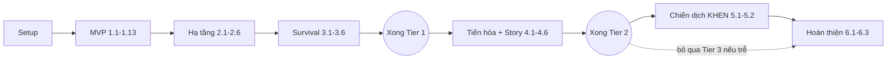

# ✅ TASKS — Danh sách công việc đầy đủ (bám sát Master Plan 36 bước)

> Nguồn: [ke-hoach-game-master.md](file:///D:/PlanProjectGame/ke-hoach-game-master.md) · Cây thư mục: [ARCHITECTURE.md](file:///d:/ProjectGame/docs/ARCHITECTURE.md) · Setup: [SETUP_AND_LIBRARIES.md](file:///d:/ProjectGame/docs/SETUP_AND_LIBRARIES.md)
> Ký hiệu: `[C++]` engine · `[PY]` Python · `[DATA]` JSON/Tiled · `[ART]` tài nguyên · `[TEST]` kiểm thử · **DoD** = tiêu chí hoàn thành · `Eₓ` = Errata.
> Quy trình mỗi bước (RULES.md): Kế hoạch ngắn → Code → Build/Lint → Test → Tự review → Commit `feat(scope): ...`.

---

## 🗺️ Tổng quan cột mốc

| Tuần | Phần | Bước | Git tag khi xong |
|------|------|------|------------------|
| 0 | Setup | S.1 → S.6 | `v0.0-setup` |
| 1–6 | Phần 1 — MVP | 1.1 → 1.13 | `v0.1-mvp` |
| 7–8 | Phần 2 — Tier 1A | 2.1 → 2.6 | `v0.2-infra` |
| 9–10 | Phần 3 — Tier 1B | 3.1 → 3.6 | `v0.3-tier1` ✅ *Game hoàn chỉnh + Secret Ending* |
| 11–13 | Phần 4 — Tier 2 | 4.1 → 4.6 | `v0.4-tier2` ✅ *Đủ 5 Kết thúc* |
| 14–15 | Phần 5 — Tier 3 (tùy chọn) | 5.1 → 5.2 | `v0.5-tier3` |
| 16 | Phần 6 — Hoàn thiện | 6.1 → 6.3 | `v1.0` 🚀 |

---

## 🧰 GIAI ĐOẠN 0 — SETUP (Tuần 0)

### S.1 Cài công cụ
- [ ] Thêm workload **Desktop development with C++** cho VS 2022 (MSVC v143, Windows SDK, C++ CMake tools).
- [ ] Cài CMake ≥ 3.25 (hoặc dùng bản kèm VS qua Developer PowerShell).
- [ ] Clone + bootstrap vcpkg vào `C:\vcpkg`, đặt biến `VCPKG_ROOT`.
- [ ] Cài Tiled Map Editor; (tùy chọn) Audacity, LibreSprite, VS Code + extension.
- **DoD:** `cl`, `cmake --version`, `C:\vcpkg\vcpkg.exe version` đều chạy.

### S.2 Môi trường Python 3.11
- [ ] Tạo `.venv` từ `Python311\python.exe` (KHÔNG dùng 3.12 mặc định).
- [ ] `pip install -r requirements/dev.txt -r requirements/tools.txt`.
- **DoD:** `.venv` báo `3.11.x 64bit`; `pytest`, `ruff`, `mypy` chạy được.

### S.3 Git & LFS
- [ ] `git init -b main`, `git lfs install`.
- [ ] Xác nhận `.gitignore`, `.gitattributes`, `.editorconfig` đã có.
- [ ] `vcpkg x-update-baseline --add-initial-baseline` để khóa phiên bản thư viện.
- **DoD:** `git check-attr filter -- <ảnh>.png` → `filter: lfs`.

### S.4 Nhập tài nguyên `[ART]`
- [ ] Copy toàn bộ `D:\PlanProjectGame\GAME\` → `art_src/original/` (bản gốc).
- [ ] Copy 2 file prompt → `art_src/prompts/`; `map_concept_art.png` → `art_src/reference/`.
- [ ] Copy sprite/tileset/VFX/portrait vào đúng thư mục `assets/` (bảng ở SETUP §3.8).
- [ ] Ghi chú: `boar_sneak` không có → dùng `boar_walk`; `boss_run` → tái dùng `boss_patrol` tăng tốc frame.
- **DoD:** 35 PNG runtime nằm đúng chỗ.

### S.5 Đối chiếu kích thước sprite với prompt `[ART]`
- [ ] Kiểm tra bằng Pillow kích thước thực so với bảng: REX/Boar `32×32/frame`, KHEN `64×64/frame`, portrait `64×64`, tileset `256×160` (8×5).
- [ ] Ghi kết quả lệch (nếu có) vào `docs/ARCHITECTURE.md` mục ghi chú — `AnimationSystem` sẽ tự chia `texW / frameCount`.
- **DoD:** Có bảng "file — kích thước thực — frameCount" để điền `data/animations.json`.

### S.6 Bộ nhớ dự án
- [ ] Đọc `docs/PROJECT_CONTEXT.md`, `docs/adr/0001–0005`; duyệt/đổi trạng thái ADR-0003 sau Bước 1.1.
- [ ] Commit đầu: `chore: khoi tao cau truc du an` → tag `v0.0-setup`.

---

## 🔵🔴🟣 PHẦN 1 — PROTOTYPE / MVP (Tuần 1–6)

> Mục tiêu: map `25×20`, REX chạy/nấp bụi/cắn, săn 5 Lợn (chọn buff mỗi lần), Boss KHEN 2 Phase, HP bar, 6 âm thanh, Thắng/Thua.

### 1.1 Build system & khung dự án `[C++][PY]`
- [ ] `CMakeLists.txt`: C++17, tách **`dino_engine` (static lib, mọi `src/**` trừ `app/main.cpp`)** + exe `DinoSurvival` + (option) `dino_tests`.
- [ ] `CMakePresets.json`: preset `debug`/`release`, toolchain `$env{VCPKG_ROOT}/scripts/buildsystems/vcpkg.cmake`, `Python3_EXECUTABLE=.venv/Scripts/python.exe`, `pybind11_DIR`.
- [ ] `cmake/CompilerWarnings.cmake` (`/W4 /permissive- /utf-8`), `cmake/CopyRuntime.cmake` (POST_BUILD copy `assets maps data scripts`).
- [ ] `src/app/main.cpp` tối thiểu: `SDL_Init` + `py::scoped_interpreter` → in phiên bản SDL2 và `sys.version`.
- [ ] `tools/convert_webp_to_png.py` (5 file) + `tools/import_assets.py` (tự động hóa S.4).
- [ ] `tests/python/test_smoke.py` (1 test dummy).
- **DoD:** exe thoát mã 0, in `3.11.x`; 5 PNG convert có alpha; `pytest` → `1 passed`. Cập nhật ADR-0003 → *Chấp nhận*.

### 1.2 Game Loop 60 FPS + Delta Time `[C++]` (E6)
- [ ] `src/app/Constants.h`: `SCREEN_W=800`, `SCREEN_H=600`, `MAX_DT=0.05f`, `SPD_TO_PX=50.0f`, `TILE_SIZE=32`.
- [ ] `src/core/Engine.h/.cpp`: init theo thứ tự, `SDL_GetPerformanceCounter`, `dt = min(raw, MAX_DT)`, VSync, shutdown ngược thứ tự.
- **DoD:** cửa sổ 800×600 "Kỷ Nguyên Sinh Tồn", ESC/X thoát sạch, log `dt ≈ 0.0167`.

### 1.3 Bản đồ 25×20 + TileMap `[DATA][C++]`
- [ ] Tiled: `maps/tilesets/forest.tsx` (Custom Property `type`: `solid/bush/water/ground`).
- [ ] Tiled: `maps/mvp/level_01.tmx` CSV, 3 layer `Ground / Collision / Foliage` theo concept art.
- [ ] `src/world/TileMap.h/.cpp` (tmxlite): `localId = gid - firstGid`, `solidRects` từ `Collision`, `tileTypeAt`, `renderLayer(name)` có culling, chuẩn hóa path tileset bằng `std::filesystem`.
- [ ] `src/render/ResourceManager.h/.cpp`: cache texture + placeholder màu khi thiếu file.
- **DoD:** map hiển thị đúng, `solidRects.size() > 0`, ô bụi trả `"bush"`.

### 1.4 REX + WASD + AnimationSystem `[C++][DATA]` (E7)
- [ ] `data/animations.json`: 7 clip REX (idle 4, run 6, attack 4, hurt 2, dead 4, sneak 3, level_up 4) + boar + boss.
- [ ] `src/render/AnimationSystem.h/.cpp`: clip theo state, `frameW = texW / frameCount`, non-loop `isFinished`, cờ `justChangedFrame`.
- [ ] REX (tạm `src/entities/Player` → sẽ gộp `Dino` ở 2.4): HP 100, ATK 10, SPD 3.0 → 150 px/s, chuẩn hóa chéo `0.7071`, lật hướng, Space/Chuột trái cắn (giữ ATTACK hết 4 frame).
- **DoD:** 8 hướng đúng 150 px/s, attack chạy đủ frame rồi về IDLE/RUN.

### 1.5 Va chạm AABB tách trục + bụi rậm `[C++][TEST]` (E5)
- [ ] `src/world/CollisionSystem.h/.cpp`: `checkAABB`, `moveAndSlide` (X trước, Y sau, kẹp biên), hitbox 28×28 offset 2.
- [ ] Ẩn bụi: tâm REX trên ô `bush` → `hidden=true`, anim `SNEAK`, alpha 170, vẽ `Foliage` sau REX.
- [ ] `[TEST]` `tests/cpp/test_collision.cpp`: trượt tường chéo, không xuyên góc, kẹp biên, `dt` lớn.
- **DoD:** chạy chéo vào tường trượt mượt, không kẹt góc; test Catch2 pass.

### 1.6 Camera `[C++]`
- [ ] `src/render/Camera.h/.cpp`: follow damping `1 - exp(-k·dt)`, clamp (kể cả map nhỏ hơn màn), `shake(sec, power)`, `renderX/Y` làm tròn **1 lần**.
- **DoD:** xuống đáy map camera dừng đúng mép; shake ổn định lại; không khe hở tile.

### 1.7 Cầu nối Pybind11 `[C++][PY]` (E1, E4)
- [ ] `src/core/GameContext.h` (con trỏ không sở hữu tới player/preys/boss/audio/camera).
- [ ] `src/bridge/PyBridge.cpp`: **duy nhất** `PYBIND11_EMBEDDED_MODULE(game_engine, m)`; gọi `bindEntities/bindWorld/bindSystem` từ `Bind*.cpp`.
- [ ] Nhóm API MVP: Player (`get_player_x/y/hp/max_hp/atk/speed`, `set_*`, `heal/damage`, `is_player_hidden`), Prey (`get_enemy_*`, `set_enemy_state`, `move_enemy`→AABB), Boss (`get_boss_*`, `move_boss`, `boss_attack`, `apply_player_slow`, `spawn_boss`), System (`set_game_paused`, `show_upgrade_menu`, `play_sound`, `switch_boss_bgm`, `camera_shake`).
- [ ] `sys.path.insert(0, exeDir)`; mọi lời gọi Python bọc `try/catch (py::error_already_set&)` — lỗi script không crash.
- [ ] `typings/game_engine.pyi` mirror chữ ký API; `scripts/entry/gameplay_logic.py` có `update(dt)`.
- **DoD:** Python in tọa độ REX thay đổi khi bấm WASD; gõ sai biến Python chỉ in traceback.

### 1.8 AI Lợn rừng `[PY][TEST]` (E6)
- [ ] `scripts/ai/constants.py` (`BOAR_DETECT_RANGE=160`, `BOAR_STEALTH_DETECT=64`, `WANDER 25 px/s`, `FLEE 60 px/s`, `ALERT 0.35s`), `models.py`, `utils.py` (`distance`, `normalize`).
- [ ] `scripts/ai/prey_service.py`: `WANDER → ALERT → FLEE → DEAD`, dùng `dt` thực, chuẩn hóa vector wander.
- [ ] `src/entities/Prey.h/.cpp`: HP 30, thanh máu nhỏ khi bị thương.
- [ ] `[TEST]` `tests/python/conftest.py` (mock `game_engine` vào `sys.modules`) + `tests/python/ai/test_prey_service.py`.
- **DoD:** 6 lợn hành xử đúng, nấp bụi chỉ lộ khi < 2 tile; test FSM 100% pass.

### 1.9 Chỉ số & 3 Buff `[PY][DATA][C++]`
- [ ] `data/balance.json` bản MVP (`rex`, `upgrades`, `mvp.kills_to_spawn_boss=5`) + `data/schemas/balance.schema.json`.
- [ ] `scripts/config.py`: load + cache + validate kiểu cơ bản (stdlib).
- [ ] `scripts/evolution/upgrade_service.py`: `on_prey_killed`, `apply_upgrade(claw|speed|shield)`, spawn Boss khi đủ 5.
- [ ] C++: hit kiểm 1 lần ở frame 2 (`m_attackHitApplied`), `attack_cooldown 0.45s`, `atk` dạng float.
- **DoD:** claw → ATK 11.5; speed → 180 px/s; shield → MaxHP 130; con thứ 5 → rung 0.6s + Boss xuất hiện.

### 1.10 Boss KHEN 2 Phase `[PY][C++][TEST]` (E2, E6, E7)
- [ ] `src/entities/Boss` (tạm, gộp `Dino` ở 2.4): sprite 64×64, HP 300, ATK 25, SPD 1.9/3.2, Charge 5.8.
- [ ] `scripts/ai/boss_khen_service.py`: `BOSS_ATTACK_RANGE=55.0`, đủ `_do_patrol(dt)` qua 4 waypoint, `swipe_cd 1.1s`, Phase 2 ≤ 50% HP (160 px/s, roar 3s slow 40%/2s, charge 290 px/s 0.55s, `charge_cd 4.5s`).
- [ ] Thống nhất `get_*_x/y` trả **tâm** thực thể.
- [ ] `[TEST]` `tests/python/ai/test_boss_khen_service.py`: chuyển PATROL→CHASE→SWIPE, Phase 2, cooldown.
- **DoD:** tuần tra, phát hiện 320 px (110 px khi REX nấp), Phase 2 rung + charge.

### 1.11 UI cơ bản `[C++]`
- [ ] Font đủ dấu tiếng Việt vào `assets/fonts/`; `src/render/TextCache` (chỉ tạo lại khi chuỗi đổi).
- [ ] `src/ui/HUD`: portrait 64×64, HP bar `clamp(ratio,0,1)`, `Kills X/5`, HP Boss giữa trên.
- [ ] `src/ui/UpgradePanel`: 3 thẻ, hover viền vàng, click hoặc phím 1/2/3 → gọi Python `apply_upgrade`.
- [ ] Overlay Victory/Game Over + phím chơi lại.
- **DoD:** chữ "ế ộ ữ" hiển thị đúng; bảng buff hoạt động chuột + phím.

### 1.12 Âm thanh MVP `[C++][ART]` (E3)
- [ ] 6 file: `sfx/rex/rex_bite_attack.wav`, `sfx/boar/boar_squeal_death.wav`, `sfx/ui/ui_upgrade_select.wav`, `sfx/boss/boss_roar_phase1.wav`, `sfx/env/bush_rustle_enter.wav`, `bgm/bgm_jungle_explore.ogg` (+ `bgm_boss_khen_battle.ogg`).
- [ ] `src/audio/AudioManager`: missing-file safe, `switchBGM` = `Mix_FadeOutMusic` + `Mix_HookMusicFinished` → **cờ**, phát nhạc mới trong `update()` main thread; BGM ~70%, SFX 100%.
- [ ] Phát `bush_rustle_enter` chỉ khi `!wasInBush && isInBush`; cắn ở frame 2.
- **DoD:** xóa 1 file vẫn chạy; đổi nhạc Boss không khựng khung hình.

### 1.13 Playtest & chốt MVP `[TEST]`
- [ ] Hit-flash 0.1s (`SDL_SetTextureColorMod`) + knockback 12 px + `hit_effect.png`.
- [ ] Chơi ≥ 5 ván với tổ hợp buff khác nhau; chỉnh `balance.json` (giết lợn 3 phát, hạ Boss 60–120s, thắng 50–70%).
- [ ] `pytest` + test C++ xanh; không crash/kẹt tường trong 3 ván liên tiếp.
- **DoD:** tag **`v0.1-mvp`**.

---

## 🟢 PHẦN 2 — HẠ TẦNG & TRANG CHỦ (Tier 1A · Tuần 7–8)

### 2.1 SceneManager + Fade `[C++]`
- [ ] `src/core/Scene.h`, `SceneManager.h/.cpp`: `requestChange` → đổi ở **cuối frame**, Fade OUT 0.2s → swap → IN 0.2s, nhớ `SDL_BLENDMODE_BLEND`.
- [ ] Chuyển logic MVP vào `src/scenes/GameplayScene`; `Engine` chỉ giữ `SceneManager`.
- **DoD:** đổi scene 20 lần liên tiếp mượt, RAM không tăng.

### 2.2 Splash + Trang chủ `[C++][ART]`
- [ ] `src/ui/Button` (normal/hover/locked, chuột + ↑/↓/Enter, SFX hover).
- [ ] `SplashScene` 2s → `MenuScene`: parallax 3 lớp (placeholder gradient), logo `sin(t)`, bóng REX/KHEN bằng ColorMod `(10,12,18)` + alpha 180, 5 nút, 40 hạt đom đóm, `bgm_menu.ogg`.
- **DoD:** TIẾP TỤC khóa xám khi chưa có save; THOÁT đóng sạch.

### 2.3 Màn phụ + SaveSystem `[C++][TEST]` (ADR-0004)
- [ ] `src/save/SaveData.h` + `SaveSystem`: `schema_version`, `.value(key, default)`, `json::parse(..., nullptr, false)`, atomic write + `.bak`, đường dẫn `saves/save.json`.
- [ ] `ModeSelectScene`, `CharSelectScene` (KHEN 🔒 khi `unlock_khen=false`), `SettingsScene` (music/sfx slider, fullscreen `FULLSCREEN_DESKTOP` + `RenderSetLogicalSize`), `PauseOverlay` (Esc).
- [ ] `[TEST]` `tests/cpp/test_save.cpp`: round-trip, JSON hỏng → `.bak`, thiếu khóa → mặc định, version cao → từ chối; fixture `tests/fixtures/saves/save_v1.json`.
- **DoD:** cài đặt được nhớ sau khi mở lại; xóa save → TIẾP TỤC khóa, KHEN 🔒.

### 2.4 Lớp `Dino` chung + mở rộng Bridge `[C++][PY]` (E4)
- [ ] `src/entities/Types.h` (`Faction`, `Stats`, `StatusEffects`), `Dino.h/.cpp` (id, faction, branch, stage, cooldowns, stun/slow/invuln), `EntityManager` (`unordered_map<string, unique_ptr<Dino>>`, Y-sort).
- [ ] Gộp Player + Boss → `Dino("rex")`, `Dino("khen")`; hiệu lực tốc độ tính mỗi frame `base × hazard × slow`.
- [ ] Bridge đầy đủ: `get_dino_pos/hp_ratio/stats/speed/level`, `set_dino_stats`, `move_dino_toward`, `dash_dino`, `apply_stun/slow`, `set_invulnerable`, `set_faction_relation`, `targets_in_radius`, `damage_dino`, `get/set_cooldown`, `tile_type_at`, `has_food`, `get_nearest_food`, `in_lava_warning`, `is_rex_hidden/stealthed`, `spawn_exit_cave`, `show_toast`, `show_dialogue`, `show_evolution_menu`, `show_coop_choice`, `trigger_ending`, `sync_player_exp`, `unlock_ultimate_skill`, `spawn_vfx`.
- [ ] Cập nhật `typings/game_engine.pyi` + kiểm tra khởi động gọi được từng nhóm.
- **DoD:** chơi lại MVP hành vi y hệt, không tụt FPS.

### 2.5 A* có trọng số `[C++][TEST]`
- [ ] `src/world/WorldConstants.h` (1.0 / 1.5 / 3.0 / 5.0 / blocked), `Pathfinder` mảng phẳng 1D, 4 hướng, Manhattan, tái dùng buffer (không alloc mỗi lần), chọn ô đi được gần nhất nếu đích bị chặn.
- [ ] Expose `find_path(x1,y1,x2,y2)` → list tọa độ tâm ô; AI repath 0.4–0.5s.
- [ ] `[TEST]` `tests/cpp/test_pathfinder.cpp`: tường chữ U, né thorn, không có đường → rỗng, đích bị chặn.
- **DoD:** F3 vẽ đường vòng qua chữ U; 1 lần tìm < 2 ms (map 40×30).

### 2.6 Toast + Dialogue `[C++][PY][DATA]`
- [ ] `src/core/EventBus`, `src/ui/ToastManager` (tối đa 3, trượt vào, tắt sau 3s).
- [ ] `src/ui/DialogueBox`: typewriter 40 ký tự/s theo **codepoint UTF-8**, Space hiện hết, nút lựa chọn, hủy texture cũ trước khi tạo mới.
- [ ] `data/dialogues.json` (`rex_01_intro`, `rescue_choice_test`) + `scripts/story/dialogue_service.py` áp `set: {mercy, bloodlust}`.
- **DoD:** 3 toast xếp chồng gọn; chọn [Giải cứu] → mercy +10; không ký tự lỗi.
- **Tag `v0.2-infra`.**

---

## 🔴 PHẦN 3 — SURVIVAL MODE (Tier 1B · Tuần 9–10)

### 3.1 Bản đồ Núi Lửa 40×30 `[DATA][C++]`
- [ ] Tiled `maps/survival/survival_map.tmx`: 5 layer `Ground / Hazard / Collision / Foliage / Objects`, đối xứng qua tâm (20,15).
- [ ] Point Object: `spawn_rex (4,15)`, `spawn_khen (35,15)`, `food_boar`, `food_mother (20,6)`, `food_herb` (14,9 / 26,9 / 20,22), `rescue_dino`, `patrol`, `exit_cave`, `volcano_center`.
- [ ] `TileMap` đọc ObjectGroup + Custom Property `type/speed_mult/dps`; `src/scenes/SurvivalScene`.
- **DoD:** camera cuộn đủ 1280×960; F3 tô màu hazard/solid + chấm spawn.

### 3.2 Tài nguyên & Cạm bẫy `[C++][PY]`
- [ ] `src/world/HazardSystem`: mud ×0.5, thorn 3 DPS + ×0.8 (không sửa chỉ số gốc).
- [ ] `src/world/FoodSpawner`: lợn nhỏ 25s, lợn mẹ (HP 120, ATK 12) 40s, thảo dược (+40 HP, +15 EXP) 45s.
- [ ] `scripts/ai/mother_boar_service.py`: `WANDER → DEFEND` (húc 12 ATK / 1.2s, bỏ khi > 6 tile).
- [ ] `takeDamage` chung cho quái + môi trường, kiểm `hp <= 0`.
- **DoD:** bùn 75 px/s; gai 3s mất ~9 HP; lợn mẹ phản công; thảo dược mọc lại 45s.

### 3.3 KHEN tự Farm (Utility AI) `[PY][TEST]`
- [ ] `balance.json` → `khen_stages` 1/2/3 (160/14/2.4 → 230/19/2.7 @3 kills → 300/25/3.0 @7 kills).
- [ ] `scripts/ai/survival_khen_service.py`: `choose_goal` mỗi 0.5s (`ESCAPE_LAVA → HEAL → HUNT_REX → HUNT_PREY → PATROL`), A* repath 0.5s (0.35s khi HUNT_REX), Scent stage 3 (4 tile), Toast khi tiến hóa/hạ lợn mẹ.
- [ ] `[TEST]` `tests/python/ai/test_survival_khen.py`: thứ tự ưu tiên goal, tiến hóa đúng mốc.
- **DoD:** REX đứng yên 3 phút → KHEN tự săn, ăn thảo dược khi < 40%, Toast "Giai đoạn 2".

### 3.4 Vòng bo Dung nham `[C++][PY][TEST]`
- [ ] `src/world/LavaSystem`: `safeRadius = max(5, 18 − (t−300)/20)`, chỉ tính lại lưới khi `int(r)` đổi, warning nhấp nháy `100+100·sin(8t)`, 12 DPS.
- [ ] `scripts/survival/director_service.py`: 4:30 rung + Toast, 5:00 phun trào + `bgm_lava`.
- [ ] Nối `LavaSystem*` vào Pathfinder: lava = chặn, warning = 15.0.
- [ ] `[TEST]` `tests/cpp/test_lava.cpp`: bán kính theo thời gian, chặn đúng ô.
- **DoD:** (`lava_start_sec=10` để test) mỗi 20s thu 1 ô, KHEN chạy vào tâm.

### 3.5 Lãnh thổ "Show, Don't Tell" `[C++]`
- [ ] `src/world/TerritorySystem`: stamp ±0.6·dt bán kính 3, ±0.5 khi hạ mồi/ăn thảo dược, decay `pow(0.995, dt·60)`.
- [ ] Overlay hoa/héo **chỉ trên Ground**; Vignette `alpha = max(0, −inf)·160`.
- [ ] AudioManager: 2 loop `Mix_Chunk` kênh 14/15 crossfade theo `inf` tại REX.
- [ ] Thứ tự vẽ 10 lớp + Y-sort thực thể.
- **DoD:** vệt hoa sau REX mờ dần 20–30s; vào vùng KHEN tối góc + nhạc chuyển mượt.

### 3.6 Co-op Twist → Secret Ending `[PY][C++][TEST]`
- [ ] `scripts/survival/coop_service.py`: kiểm mỗi 1s, 1 lần/ván (cả hai ≤ 20% HP, hoặc r = 5 & < 8 tile), hộp thoại 15s (hết giờ = Chiến đấu), xác suất KHEN đồng ý.
- [ ] Đồng ý → `ALLY`, `spawn_exit_cave`, đếm 30s, đá rơi (`render/VFXSystem` báo bóng 1.2s, 20 DMG + choáng 0.5s), KHEN goal `GO_TO_EXIT`.
- [ ] REX vào hang khi KHEN còn sống → Secret Ending, ghi `endings_seen`; hết 30s → Bad.
- [ ] `[TEST]` `tests/python/survival/test_coop_service.py`.
- **DoD:** F4 ép 15% HP → hộp thoại; vào hang → `"secret"` trong save.
- **Tag `v0.3-tier1` — ĐÃ CÓ GAME HOÀN CHỈNH.**

---

## 🟣 PHẦN 4 — TIẾN HÓA 3 NHÁNH & STORY REX (Tier 2 · Tuần 11–13)

### 4.1 EXP / Level / EvolutionPanel `[PY][C++][TEST]`
- [ ] `scripts/evolution/constants.py` (`50/120/220/350`), `models.py` (`Branch`, `BuffChoice`), `exp_service.py` (vòng `while`, +5 EXP/30s, hàng đợi `pending_menus`).
- [ ] `src/ui/EvolutionPanel` (Lv3, 3 thẻ), HUD thanh EXP + `Lv.X`.
- [ ] `[TEST]` `tests/python/evolution/test_exp_service.py`: +130 EXP từ Lv1 → qua Lv2 và Lv3, menu xếp hàng.
- **DoD:** Lv2/Lv4 bảng buff, Lv3 bảng tiến hóa, Lv5 Toast chiêu cuối.

### 4.2 3 nhánh tiến hóa + Đồng minh `[C++][PY]`
- [ ] `balance.json` → `evolution.tyrant/raptor/pack` (hp/atk/spd mult, scale).
- [ ] `Dino::render`: ColorMod + scale căn đáy chân + overlay phụ kiện (placeholder), **reset ColorMod** sau vẽ; hitbox tường ≤ 30 px.
- [ ] `scripts/ai/ally_service.py`: `FOLLOW (vòng cung 48 px) → ASSIST (10 ATK/1s) → FLEE (< 30%)`, tối đa 3, A* khi xa > 6 tile; giữ E 2s giải cứu (+30 EXP, +10 Mercy).
- **DoD:** raptor 210 px/s, nhỏ 0.9×, xanh; pack giải cứu → đồng minh phụ đánh.

### 4.3 Kỹ năng Q/E/Nội tại/Lv5 `[PY][C++][TEST]`
- [ ] `scripts/evolution/skills_service.py`: dispatch table `(branch, key)` đủ 9 handler + bảng cooldown.
- [ ] C++: `perform_bite`, `dash_dino` chia 6 bước × 16 px qua `moveAndSlide`, stealth = `(inBushIdle ≥ 1s && !recentlyAttacked) || ghostUlt > 0`.
- [ ] HUD ô `[Q] [E] [R]` + overlay cooldown.
- [ ] `[TEST]` `tests/python/evolution/test_skills_service.py`: cooldown chặn, R cần Lv5, handler đúng nhánh.
- **DoD:** Tyrant E choáng 2 tile; Raptor Q không xuyên tường; Pack Q/E đổi mục tiêu đồng minh.

### 4.4 Nghiệp quả & 5 Kết thúc `[PY][TEST]`
- [ ] `scripts/karma/constants.py`, `models.py`, `karma_service.py` (`add_bloodlust/add_mercy` là cổng duy nhất), aura đỏ ≥ 40, ánh vàng mercy ≥ 25.
- [ ] `scripts/karma/ending_service.py`: `resolve_ending()` hàm thuần → `secret/bad/true/twist/neutral`.
- [ ] `[TEST]` `tests/python/karma/test_ending_service.py` đủ 5 tổ hợp + biên (mercy 29/30, bloodlust 59/60).
- **DoD:** 5/5 pass; aura hiển thị khi bloodlust ≥ 40.

### 4.5 Story Mode + 3 màn REX `[PY][DATA][C++]`
- [ ] `scripts/story/models.py`, `level_loader.py` (validate, `LevelNotFoundError`), objectives `hunt/reach/rescue/survive/evolve/defeat_boss`.
- [ ] `data/levels/rex_01.json` (map `mvp/level_01.tmx`), `rex_03.json` (`story/story_swamp.tmx`), `rex_05.json` (`story/story_volcano.tmx`) + hội thoại Canon V2.5.
- [ ] `src/scenes/StoryScene` + Quest Tracker; lưu snapshot (level, exp, branch, buffs, karma) khi chuyển màn.
- **DoD:** chơi liền 1 → 3 → 5, giữ nhánh + karma.

### 4.6 EndingScene + mở khóa KHEN `[C++][DATA]`
- [ ] `data/endings.json` (5 kết thúc), `src/scenes/EndingScene` (ảnh/placeholder, typewriter, jingle, thống kê, Space 2 lần).
- [ ] Ghi `endings_seen` không trùng; thắng Story REX → `unlock_khen = true` + banner.
- **DoD:** F5 mở đủ 5 ending; KHEN hết 🔒 sau `rex_05`.
- **Tag `v0.4-tier2`.**

---

## 🟣 PHẦN 5 — CHIẾN DỊCH KHEN (Tier 3 · Tùy chọn · Tuần 14–15)

### 5.1 Điều khiển KHEN + REX AI `[C++][PY]`
- [ ] `controlledByPlayer` cho `Dino("khen")`, camera theo KHEN, `boss_patrol` frameDelay 0.07 làm anim chạy, hitbox 30×30.
- [ ] 4 kỹ năng: Swipe (nón 60°, dot ≥ 0.866, 55 px, CD 1s), Charge (5 tile ×1.5, CD 6s), Roar (3 tile slow 40% 2s, CD 10s), Scent (lộ bụi 4 tile 5s, CD 15s).
- [ ] `scripts/ai/rex_ai_service.py`: săn, trốn bụi khi KHEN gần & HP < 60%, tự chọn nhánh Lv3, né lava; thêm `get_nearest_bush_away_from`, `apply_dino_branch`.
- **DoD:** Survival chọn KHEN chơi mượt; Scent lộ REX Raptor.

### 5.2 3 màn KHEN `[DATA][PY]`
- [ ] `data/levels/khen_01.json`, `khen_02.json`, `khen_03.json` với `"playable_character": "khen"`, `boss_rex_stats` cho màn cuối.
- [ ] Node hội thoại góc nhìn Người Gác Rừng trong `data/dialogues.json`.
- [ ] Chặn chiến dịch khi `unlock_khen == false` ("Hoàn thành chiến dịch REX để mở khóa").
- **DoD:** chơi liền 3 màn, kết thúc kích hoạt Ending.
- **Tag `v0.5-tier3`.**

---

## 🟣 PHẦN 6 — HOÀN THIỆN & PHÁT HÀNH (Tuần 16)

### 6.1 Âm thanh đủ + VFX `[ART][C++]`
- [ ] 31 SFX + 3 BGM V1 + 12 audio V2 (`bgm_menu`, `bgm_rex_territory`, `bgm_khen_territory`, `bgm_lava`, `dash`, `stomp`, `evolve`, `toast`, `lava_warn`, `ending_jingle`...).
- [ ] 7 sheet VFX: `vfx_bite_slash`, `vfx_level_up_aura`, `vfx_roar_shockwave`, `vfx_dust_puff`, `vfx_stealth_leaves`, `vfx_water_ripple`, `vfx_alert_bubble`.
- [ ] `src/render/VFXSystem`: `std::array<VfxInstance,128>` không alloc trong frame; keyframe SFX/VFX theo `justChangedFrame`; SFX cooldown 0.06s/ID.
- **DoD:** cảnh nặng nhất ≥ 55 FPS, âm không rè.

### 6.2 Debug + Tối ưu + Cân bằng `[C++][DATA]`
- [ ] `src/debug/DebugOverlay`: F3 hitbox/A*/influence/FPS, F4 ép 15% HP, F5 test Ending/Level+, F6 hot-reload `balance.json` (validate trước, lỗi giữ bản cũ); F4–F6 chỉ trong `_DEBUG`.
- [ ] `balance.json` hoàn chỉnh (rex, khen_stages, prey, survival, evolution) + `tools/validate_data.py` chạy sạch.
- [ ] Playtest: Survival thắng 40–60%, cả 3 nhánh có đường thắng; đổi scene 10 lần RAM ổn định.
- **DoD:** F6 đổi tốc độ REX tức thì; không leak.

### 6.3 Release & Phát hành `[C++][TEST]`
- [ ] `cmake --preset release` (`/O2`), cân nhắc `/MT` hoặc ghi chú VC++ Redist.
- [ ] `tools/package_release.ps1` → `dist/DinoSurvival_v1.0/`: exe + DLL vcpkg + `python311.dll`, `python311.zip`, `python311._pth` (`python311.zip`, `.`, `scripts`) + `assets` (không `art_src`) + `maps` + `data` + `scripts` + `README.txt`; **không** kèm `saves/`.
- [ ] Đặt `PYTHONHOME`/`PyConfig` trỏ thư mục game trước khi tạo interpreter.
- [ ] Test trên **Windows Sandbox**: mở thẳng Menu, nhạc, font Việt, lưu được save, không lỗi DLL.
- [ ] Zip `DinoSurvival-Win64-v1.0.zip` → Itch.io ($0 or donate) + GameJolt, 4–5 ảnh chụp, tag `#survival #pixel-art #dinosaur`.
- **DoD:** tag **`v1.0`** 🚀

---

## 📋 Checklist chất lượng áp dụng MỌI bước (RULES.md)

- [ ] Không magic number: số gameplay trong `data/balance.json`, hằng engine trong `Constants.h` có đơn vị.
- [ ] Chuyển động/timer nhân `dt`; `px/s = SPD × 50` (E6, E7).
- [ ] Di chuyển luôn qua AABB tách trục (E5); Python không tự set tọa độ.
- [ ] Không `SDL_Delay` trong loop (E3); không alloc trong hot-path; không tạo texture chữ mỗi frame.
- [ ] Lời gọi Python bọc `py::error_already_set`; Python runtime chỉ stdlib.
- [ ] Hàm ≤ ~40 dòng, file ≤ ~400 dòng; import chéo miền ghi rõ tên module.
- [ ] Test bắt buộc: toán/AABB/A*/Lava, Save, FSM AI, ending. Game feel/Camera/VFX/UI: ghi cách kiểm thủ công.
- [ ] `ruff check` + `pytest` + build `/W4` sạch trước commit; ảnh/âm thanh qua Git LFS.
- [ ] Quyết định kiến trúc mới → thêm ADR trong `docs/adr/`.
